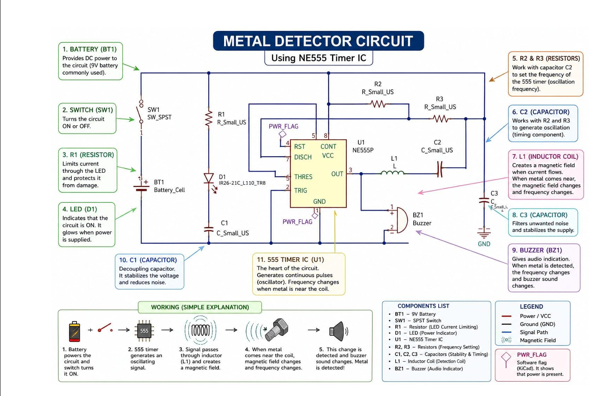
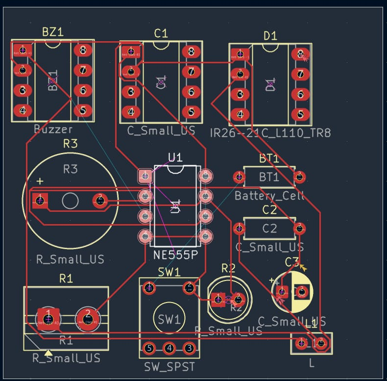
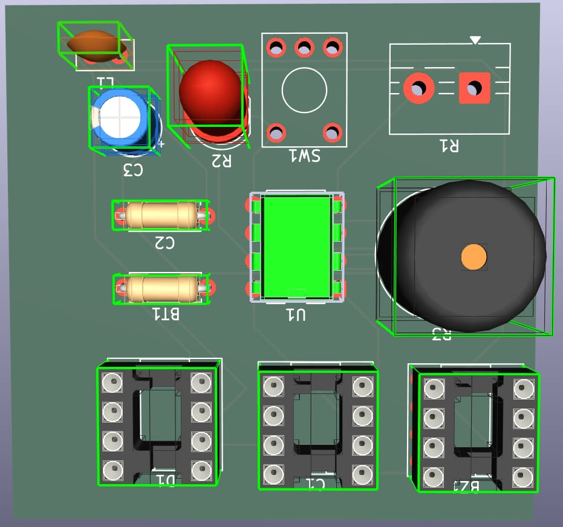
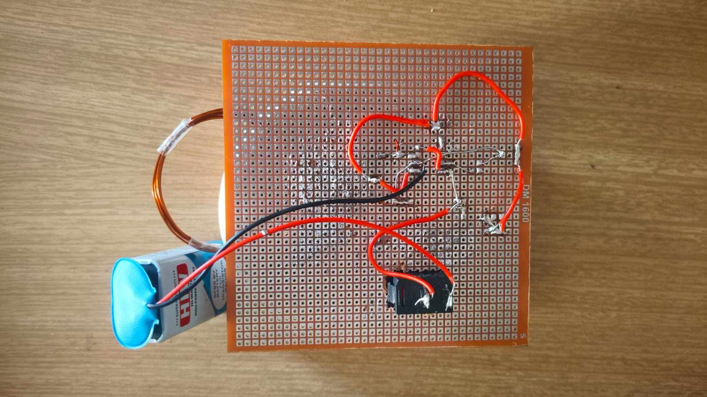
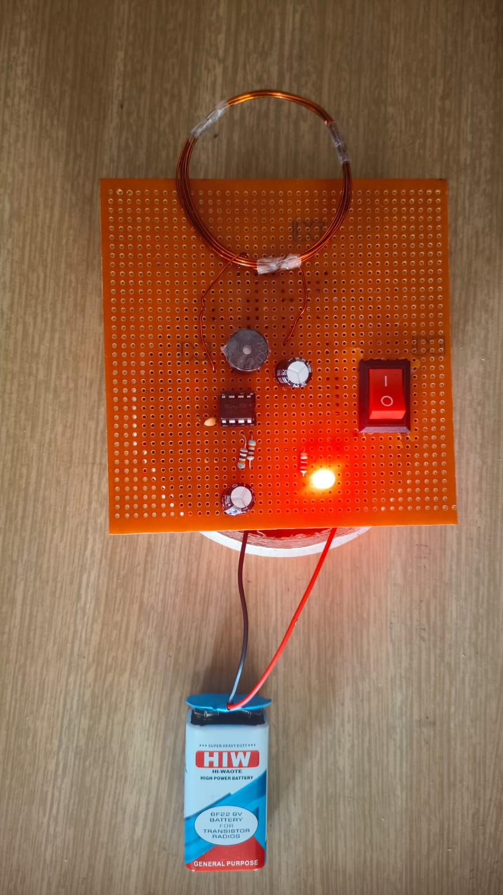

# 🔎 Metal Detector Using NE555 Timer IC

A low-cost electronics project developed using the NE555 timer IC, an inductive search coil, and basic electronic components to explore metal detection through an electronic circuit.

<p align="center">
  
</p>

<p align="center">
  <b>Analog Electronics | NE555 Timer | PCB Design | Hardware Prototyping</b>
</p>

---

## 📌 1. Project Overview

The **Metal Detector Using NE555 Timer IC** is an academic electronics project developed as part of the PCB Design and Fabrication subject during the second year of Electronics and Telecommunication Engineering.

The prototype uses an NE555 timer IC, an inductive coil, resistors, capacitors, a red LED, and a buzzer. The circuit is powered by a 9V battery and assembled on a perforated PCB.

The project demonstrates practical electronics concepts, including timer circuits, inductive sensing, PCB layout, soldering, circuit assembly, and hardware testing.

## 🎯 2. Project Objectives

* Understand the operation of the NE555 timer IC.
* Build a basic metal detector circuit.
* Explore the interaction between an inductive coil and nearby metallic objects.
* Learn PCB component placement and track routing.
* Practise through-hole soldering and hardware assembly.
* Understand the role of resistors and capacitors in timer circuits.
* Test the prototype using different objects.
* Develop practical analog electronics and debugging skills.

## 🧰 3. Hardware Components

The following components are documented in the project report.

| No. | Component                   | Specification                             | Purpose                                |
| --: | --------------------------- | ----------------------------------------- | -------------------------------------- |
|   1 | Timer IC                    | NE555, DIP-8                              | Main timing and oscillator circuit     |
|   2 | Inductive coil              | 10 mH, as documented                      | Intended metal-sensing element         |
|   3 | Resistor                    | 1 kΩ                                      | Current limiting and circuit operation |
|   4 | Resistors                   | 10 kΩ, 2 units                            | Timing network                         |
|   5 | Capacitors                  | 2.2 µF, 2 units                           | Timing network                         |
|   6 | Capacitor                   | 100 nF                                    | Bypass and noise reduction             |
|   7 | LED                         | Red                                       | Visual indication                      |
|   8 | Buzzer                      | As used in the prototype                  | Audible indication                     |
|   9 | Battery                     | 9V                                        | Power supply                           |
|  10 | Switch                      | SPST                                      | Power ON/OFF control                   |
|  11 | IC socket                   | 8-pin                                     | NE555 mounting                         |
|  12 | PCB                         | Approximately 2 × 3 inches, as documented | Component mounting                     |
|  13 | Battery connector and wires | Suitable for the circuit                  | Power and electrical connections       |

**Note:** Verify the component values and quantities against the final assembled circuit before reproducing the design.

## ⚙️ 4. Working Principle

### 4.1 Power Supply

A 9V battery supplies electrical power to the circuit. An ON/OFF switch allows the circuit to be powered up or shut down.

### 4.2 NE555 Timer IC

The NE555 is the main active component in the design. The project report describes its operation as an astable oscillator.

In astable mode, the NE555 can generate a repeating output waveform. The timing behaviour depends on the circuit topology and the connected resistors and capacitors.

### 4.3 Inductive Search Coil

The circuit includes an inductive coil intended to interact with nearby metallic objects.

A changing current in a coil creates a magnetic field. A nearby metal object can affect the coil's electrical behaviour through electromagnetic interactions.

The exact way these changes influence the NE555 output depends on how the coil is connected to the circuit. That relationship must be confirmed through circuit analysis and measurement.

### 4.4 Visual and Audible Indication

The prototype contains a red LED and a buzzer.

* **Red LED:** Provides a visual indication.
* **Buzzer:** Provides an audible indication.

The circuit diagram and project report associate these outputs with the detector's operation. The exact activation conditions should be verified against the physical circuit and experimental observations.

## 🔌 5. Circuit Diagram

The following diagram documents the circuit arrangement described in the project report.


The diagram identifies the NE555 timer IC, detection coil, resistors, capacitors, battery, switch, LED, and buzzer.

Before reproducing the circuit, verify the pin connections, component polarities, and electrical values against the actual hardware.

## 🖥️ 6. PCB Design

PCB design and component placement were part of the project. The following images document the design and hardware assembly.

### 6.1 PCB Track Layout

The track layout illustrates the intended electrical connections between circuit components.



### 6.2 PCB Component Layout

The component layout shows the planned placement of components on the PCB.



### 6.3 Soldering and Wiring

The soldering-side photograph documents the physical wiring and assembly of the circuit.



## 📸 7. Working Prototype

The prototype includes the detection coil, NE555-based circuit, red LED, ON/OFF switch, and 9V battery.



This photograph documents the physical implementation of the project.

## 🧪 8. Testing and Observations

The project report describes testing the detector with several objects, including a coin, a metal spoon, an iron bolt, aluminium foil, and a plastic object.

The following table records the observations reported in the project document.

| Test object    | Material identified in the report  | Reported detection distance |
| -------------- | ---------------------------------- | --------------------------: |
| 1 Rupee coin   | Steel, as identified in the report |                      4–5 cm |
| Metal spoon    | Stainless steel                    |                      7–8 cm |
| Iron bolt      | Iron                               |                     8–10 cm |
| Aluminium foil | Aluminium                          |                      2–3 cm |
| Plastic pen    | Plastic                            |       No detection reported |

**Important:** These values are reported results from the project document. They have not been independently verified through repeated testing.

Actual detection performance may vary with the object, coil geometry, orientation, circuit construction, and test conditions. These values should not be treated as guaranteed detection ranges.

## 🧠 9. Engineering Concepts Demonstrated

This project provides practical experience with:

* NE555 timer IC operation.
* Astable oscillator concepts.
* Resistor-capacitor timing networks.
* Inductors and electromagnetic interactions.
* Analog electronic circuit design.
* PCB layout and component placement.
* Through-hole soldering.
* Battery-powered circuit construction.
* Hardware testing and troubleshooting.
* Technical documentation.

## ⚠️ 10. Limitations

* Detection range is limited and may vary between objects.
* Detection performance depends on coil characteristics and object orientation.
* The detector does not identify the exact type of metal.
* Reported detection distances require repeatable experimental verification.
* The exact relationship between the coil and the oscillator response needs confirmation.
* No independently verified false-alarm rate or long-term reliability data is currently documented.
* The prototype is not a certified security, industrial inspection, or safety device.

## 🚀 11. Future Improvements

Potential improvements include:

* Verify the circuit against the assembled hardware.
* Measure the NE555 output waveform with an oscilloscope.
* Compare output behaviour with and without nearby metal.
* Conduct repeatable detection-range experiments.
* Record test conditions and measured results.
* Improve PCB routing and soldering documentation.
* Add a detailed NE555 pin-connection table.
* Improve mechanical protection and portability.

## 🔋 12. Power and Safety

The documented prototype uses a 9V battery.

Before powering or modifying the circuit:

* Check the battery polarity.
* Confirm the NE555 pin orientation.
* Inspect solder joints for shorts.
* Verify LED and electrolytic capacitor polarity.
* Check the buzzer's voltage and current requirements.
* Disconnect the battery before soldering or changing connections.
* Avoid short-circuiting the battery terminals.

## 📂 13. Repository Structure

```text
N555-Timer-IC-Based-Metal-Detector/
│
├── README.md
│
├── circuit/
│   ├── circuit-diagram.png
│   └── README.md
│
└── images/
    ├── README.md
    ├── pcb-component-layout.jpeg
    ├── pcb-soldering-side.jpeg
    ├── pcb-track-layout.jpeg
    └── working-prototype.jpeg
```

## 👨‍🎓 14. Project Information

| Field            | Details                                          |
| ---------------- | ------------------------------------------------ |
| Project title    | Metal Detector Using NE555 Timer IC              |
| Department       | Electronics and Telecommunication Engineering    |
| Institution      | D. Y. Patil College of Engineering, Akurdi, Pune |
| Academic year    | 2025–2026                                        |
| Subject          | PCB Design and Fabrication                       |
| Project category | Analog Electronics and Hardware Prototyping      |

## 🤝 15. Acknowledgements

This project was developed as part of academic coursework in PCB Design and Fabrication.

## 📜 16. Disclaimer

This project is intended for educational and demonstration purposes. Reported detection distances are not guaranteed performance specifications. The circuit should be verified and tested before practical use.

---

**Project repository:** [N555-Timer-IC-Based-Metal-Detector](https://github.com/khairnarparth291-crypto/N555-Timer-IC-Based-Metal-Detector)
